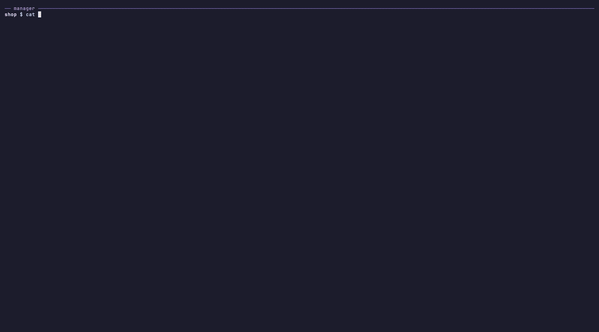

<h1 align="center">squad-devkit</h1>

<p align="center"><strong>One manager agent. On-demand workers. Fewer tokens.</strong></p>

<p align="center">
  <a href="https://github.com/bthanhtung/squad-devkit/actions/workflows/ci.yml"></a>
  <a href="https://github.com/bthanhtung/squad-devkit/releases"></a>
  <a href="./LICENSE"></a>
  
</p>

squad-devkit turns one terminal into an engineering team. You talk to a single
manager agent (Claude Code by default). The manager triages the request, plans
it, gives each task to the most cost-effective worker that can do it well
(Claude, Codex, Grok, Antigravity, or a cheap local model), verifies every
result, and sends back anything that is wrong. Workers start only when there is
work and stop when they are done, so idle agents cost nothing.

<p align="center">
  
</p>

<p align="center"><sub>A real run in tmux: three Claude haiku workers fix a bug, write tests, and update docs in parallel, each in its own git worktree, then everything is merged and the tests pass.</sub></p>

**Contents:** [Highlights](#highlights) · [Install](#install) ·
[Usage](#usage) · [Workers](#workers) · [Monitor and savings](#monitor-and-savings) ·
[Configuration](#configuration) · [Project status](#project-status) · [Security](#security) ·
[FAQ](#faq) · [Contributing](#contributing) · [Credits](#credits) · [License](#license) ·
[squad CLI reference](./docs/squad-cli.md)

## Highlights

- **Plans like a senior team.** Every request is triaged (workstream, risk,
  complexity, whether a human must decide) and planned from five perspectives:
  principal engineer, engineering manager, technical lead, QA, and end user.
- **Right worker for the job.** Workers are chosen by trust and cost:
  `claude` > `codex` > `grok`, `agy` > `ccr`. Claude workers use the smallest
  model that fits (haiku by default, sonnet or opus when needed).
- **The manager owns the outcome.** Reports are checked against `git diff` and
  re-run verification; defects go back to the same worker with `path:line`
  detail, moving up a model or engine if a fix fails twice.
- **Workers can push back.** A worker can question the manager or another
  worker (`squad-ask`) when the brief is ambiguous or there is a better approach.
- **Isolated by default.** In a git repository every editing worker gets its
  own worktree and branch, so parallel workers never overwrite each other; the
  manager reviews each diff and merges it with a three-way merge.
- **Nothing hangs.** Workers have a time limit and stall detection; failures
  report to the manager, which re-runs or reassigns the task.
- **Live visibility.** Each worker opens a monitor pane beside the manager in
  tmux, Orca, Herdr, WezTerm, Kitty, iTerm2, or Ghostty; other terminals
  (macOS Terminal.app, GNOME Terminal, Konsole, ...) need tmux for manager workers; standalone runs may open a dashboard. With claude-hud, the manager's status line shows your weekly quota
  and the tokens the squad saved.
- **Lean by design.** Instructions live in the system prompt, workers start with
  MCP servers off, old run data is pruned automatically, and a Codex manager
  takes over if Claude Code hits its usage limit.

## Install

Requirements: macOS or Linux, [`squad`](./docs/squad-cli.md), `jq`, one manager
CLI (`claude`, `codex`, `agy`, `gemini`, `grok`, or `opencode`), and at least one
worker engine (`claude`, `codex`, `grok`, `agy`, or `ccr` from
[claude-code-router](https://github.com/musistudio/claude-code-router)).
Manager monitor splits work in tmux, Orca, Herdr, WezTerm, Kitty, iTerm2, and Ghostty; Zellij requires tmux for manager runs;
other terminals need tmux for manager workers; standalone runs may open a dashboard.

```bash
# macOS
brew install mco-org/tap/squad jq

# Linux (or anywhere with Rust): build squad from source, jq from your package manager
cargo install --git https://github.com/mco-org/squad.git
sudo apt-get install jq        # or dnf, pacman, ...

git clone https://github.com/bthanhtung/squad-devkit.git
squad-devkit/scripts/install-devkit.sh
```

Prebuilt `squad` binaries for Linux are also on the
[squad releases page](https://github.com/mco-org/squad/releases). Make sure
`~/.local/bin` is on your `PATH`.

The installer links `squad-devkit`, `squad-worker`, and `squad-monitor` into
`~/.local/bin`, picks the manager (Claude Code if installed, otherwise it asks
which installed CLI to use), lists the worker engines it found, and, when
claude-hud is installed, turns on its weekly-quota and usage-pace display.
Run `squad-devkit --setup` to choose another manager later.

The installer also adds a `squad-devkit` skill to Claude Code and Codex
(`~/.claude/skills`, `~/.codex/skills`, linked to this repository so `git pull`
updates it). In any session you can then ask to hand work to workers, check
them, or merge a worker's worktree, without starting a separate manager.
`squad-devkit --doctor` checks the setup.

## Usage

```bash
squad-devkit                                          # from ~: general workspace; in a repo: that repo
squad-devkit "check prod error logs since 18:00 and write a report"
squad-devkit my-service "add rate limiting to the public API"
squad-devkit my-service --tmux                        # or --ghostty for a new window
squad-devkit --version
```

Describe the work in the chat. The manager investigates, writes a plan to
`.squad/plans/`, starts workers in parallel, answers their questions, verifies
their results, and reports back with evidence. From your home directory it runs
in the general workspace `~/.squad-devkit`, where requests such as log checks
and reports need no repository; for code changes it finds the repositories
involved. In git repositories the launcher leaves the working tree clean.

## Workers

The manager runs workers for you; you can also run them yourself:

```bash
squad-worker dev-1 --engine codex --role dev --brief-file brief.md
squad-worker review-1 --engine claude --model sonnet --role reviewer --brief "Review git diff for src/api/"
squad-worker logs-1 --engine codex --role researcher --mcp grafana-logs --brief "..."
squad-worker --list                 # running workers and unmerged worktrees
squad-worker --merge dev-1          # apply dev-1's worktree changes (uncommitted)
squad-worker --discard dev-1        # or drop them
squad-worker --stop dev-1           # or --stop all
```

| Engine | Trust | Use for |
|---|---|---|
| `claude` | highest | Work that must be right the first time; `haiku` by default, `sonnet` for complex or high-risk work, `opus` for the hardest |
| `codex` | high | Normal implementation, debugging, and tests; the only engine with MCP access |
| `grok`, `agy` | medium | Low-risk implementation or a second opinion (experimental) |
| `ccr` | basic | Docs and small exact edits; cheap model, file tools only |

Roles: `dev`, `tester`, `reviewer`, `researcher`, or any name; a role with a file
in `.squad/roles/` gets that prompt. Use `--project <path>` to work in another
repository.

In a git repository, editing workers run in their own worktree under
`.squad/worktrees/` on branch `squad/<id>`, started from a snapshot of
your working tree (including uncommitted and new files). Your files and index
stay untouched until `--merge`, which applies the changes uncommitted with a
three-way merge and leaves conflict markers if two workers changed the same
lines. Reviewers and researchers read the project directly; `--no-worktree`
does the same for any role.

## Monitor and savings

Each worker pane streams its activity (commands, file changes, tool calls,
messages) under a single live status line, without redrawing the screen, so it
never flickers. When the run ends it shows a summary, the merge command, and the
report, then closes itself 60 seconds later.
Manager workers require a confirmed split and a rendered live monitor before the engine starts. If the terminal cannot split, use `squad-devkit --tmux`; disabling panes causes the run to fail. Standalone workers use best-effort panes and may open a dashboard instead.
For independent panes in Terminal.app, use `squad-devkit --tmux`.
Orca needs its running CLI, `jq`, and a manager launched with `--here` from an
Orca terminal (`ORCA_PANE_KEY`), or an explicit runtime-issued
`SQUAD_DEVKIT_ORCA_TERMINAL` handle. No active terminal is selected implicitly.
Herdr desktop (`HC_TERMINAL_ID`) uses `herdr-app` and `jq` to resolve the
manager terminal to a unique local pane (`spaces[].machine: null`), splits
explicitly in that tab with `cwd` preserved via `argv`, verifies the created
pane/terminal in `herdr-app ls`, and restores manager focus; Herdr TUI
(`HERDR_ENV=1`, `HERDR_PANE_ID`) uses `herdr pane split`.

`squad-monitor --all` shows every run as a table in any terminal. With
claude-hud, the manager's status line adds the squad label, for example
`squad 2 running · saved 1.2M tok (+3.4M cache) · claude workers 0.8M (+12M cache)`:
the fresh tokens (input not served from cache, plus output) that workers on
other engines processed instead of Claude during this session; cache reads are
shown separately because they cost far less.

## Configuration

| Variable | Default | Purpose |
|---|---|---|
| `SQUAD_DEVKIT_MANAGER` | saved choice, else `claude` | Manager CLI for a run (`--manager`) |
| `SQUAD_DEVKIT_PERMISSION_MODE` | `auto` | Claude Code permission mode for the manager |
| `SQUAD_DEVKIT_FALLBACK_MANAGER` | `codex` | Manager that takes over when Claude Code hits a limit (`none` disables) |
| `SQUAD_DEVKIT_RETENTION_DAYS` | `7` | Days to keep finished worker runs |
| `SQUAD_DEVKIT_MAX_MB` | `200` | Size cap for `.squad/workers` |
| `SQUAD_DEVKIT_STATUSLINE` | `1` | `0` turns off the squad status-line label |
| `SQUAD_WORKER_CLAUDE_MODEL` | `haiku` | Default model for Claude workers |
| `SQUAD_WORKER_CODEX_PROFILE` | CLI configuration | Default Codex profile for workers |
| `SQUAD_WORKER_TIMEOUT` / `SQUAD_WORKER_STALL` | `45` / `10` | Minutes before a run is stopped / counted as stuck |
| `SQUAD_WORKER_PANE_HOLD` | `60` | Seconds a finished monitor pane stays open |
| `SQUAD_WORKER_WORKTREE` | `auto` | `0` disables git worktree isolation |
| `SQUAD_WORKER_SANDBOX` | `1` | `0` disables engine sandbox (Codex and Claude workers) |
| `SQUAD_DEVKIT_ROUTER_URL` | unset | Optional advisory triage router for `squad-route` |

`squad-devkit --clean` prunes old worker runs on demand and `--clean-all`
removes every finished run. Full reference:
[docs/squad-devkit.md](./docs/squad-devkit.md).

## Project status

squad-devkit 1.0 runs daily on macOS with Claude Code as the manager and Codex
and ccr workers. What has been verified end to end, and what is still
experimental:

| Area | Status |
|---|---|
| Claude Code manager, Codex and ccr workers, worktrees and merging | Verified in real runs |
| Monitor panes in Herdr desktop (`herdr-app`, local spaces), Herdr TUI, tmux, and Ghostty | Verified in real runs (AGY CLI may still exit 1 after emitting a successful result event, marking wrapper status failed) |
| Codex manager fallback when Claude Code hits a limit | Handoff verified with a simulated limit error |
| Claude workers | File edits verified; shell commands rely on Claude Code's sandbox |
| `grok` and `agy` workers; `agy`, `gemini`, `grok`, `opencode` managers | Experimental: built from each CLI's documentation, covered by tests with stand-in CLIs; AGY CLI may exit 1 after a successful result event |
| Panes in Orca, WezTerm, Kitty, iTerm2, Zellij; dashboard in Terminal.app and Linux desktops | Experimental: built from each terminal's documented API, covered by tests with stand-in commands |
| Linux | Covered by CI (Ubuntu); real-world reports welcome |

If you try an experimental path, please report what worked or failed in an
[issue](https://github.com/bthanhtung/squad-devkit/issues/new/choose).

## Security

Codex workers run sandboxed to the project, Claude workers accept edits and run
shell commands only inside Claude Code's sandbox, and ccr workers get file tools
only. squad-devkit never stores credentials, and worker prompts forbid reading
them from configuration files. See [SECURITY.md](./SECURITY.md) for details and
how to report a vulnerability.

## FAQ

**Why not just use Claude Code subagents?**
Subagents run inside your Claude Code session on Claude models, so every task
draws from the same quota. squad-devkit keeps Claude for planning and review
and sends the bulk of the work to other engines (Codex, cheap ccr models), each
in its own process and git worktree, with a time limit and a live pane you can
watch or stop.

**How many tokens does it actually save?**
Two measured examples: a trivial edit by a Codex worker costs about 18k tokens
instead of 52–98k, because workers start with MCP servers off; and the earlier
setup with three always-on workers burned about 1M tokens polling before any
work arrived, which on-demand workers avoid entirely. The status line shows the
running total for your own session. See
[Why this saves tokens](./docs/squad-devkit.md#why-this-saves-tokens).

**Do I need Claude Code?**
No. It is the default and best-tested manager, but Codex, Gemini CLI, Grok,
Antigravity, and OpenCode can manage too (`squad-devkit --setup`).

**Can a worker break my repository?**
Editing workers never touch your working tree. They work on a `squad/<id>`
branch in `.squad/worktrees/`, and nothing reaches your files until the manager
(or you) runs `squad-worker --merge`, which leaves the changes uncommitted for
review.

**Windows?**
Not supported yet. WSL has not been tested; reports are welcome.

## Contributing

Contributions are welcome. See [CONTRIBUTING.md](./CONTRIBUTING.md) for the
development setup and the checks CI runs, and [CHANGELOG.md](./CHANGELOG.md)
for release notes.

## Credits

squad-devkit is built by [TungDaDev](https://github.com/bthanhtung) on
[squad](https://github.com/mco-org/squad) by mco-org, which provides the SQLite
message bus, task records, and the `squad` CLI.

## License

squad-devkit is released under the [GNU General Public License v3.0](./LICENSE).
You may use, study, share, and modify it; if you distribute a modified version,
it must stay under GPL-3.0 with its source available.

The code that comes from the upstream squad CLI keeps its original MIT license
and copyright notice, in [LICENSES/MIT-squad.txt](./LICENSES/MIT-squad.txt).

### Opt-in YOLO sessions

`squad-devkit --yolo --manager codex` starts a session with native engine
permission bypass; workers started by that manager inherit it. Claude, Codex,
and AGY are supported. `squad-worker dev-1 --engine claude --yolo --brief "Run the checks"`
opts in a single worker independently. Without opt-in, existing behavior is unchanged.

The session boolean `SQUAD_DEVKIT_YOLO=1` carries opt-in through here, tmux,
Ghostty, and manager fallback; `0` disables inheritance. It is never saved to
configuration. Unsupported engines reject YOLO. YOLO conflicts with worker
`--sandbox` and `SQUAD_WORKER_SANDBOX=1`; omit YOLO to use sandboxing.
Claude uses `--dangerously-skip-permissions` with session sandboxing disabled,
Codex uses `--dangerously-bypass-approvals-and-sandbox`, and AGY uses
`--dangerously-skip-permissions` without `--sandbox`.

Use only in an environment you trust: this bypasses engine permission checks
and engine sandboxing, not OS/admin restrictions. Conversational instructions
are not permission controls. No global settings or role instructions change.
An existing tmux session keeps its original mode; exit it before changing modes.

### Worker model selection

`--model NAME` overrides `SQUAD_WORKER_<ENGINE>_MODEL` (uppercase engine:
`CLAUDE`, `CODEX`, `OPENCODE`, `GROK`, `AGY`, `CCR`). Empty environment values
use the default: Claude uses `haiku`; other engines use their CLI default.
Codex `--profile` selects a configuration profile, not a model; an explicit
model overrides the profile's model. Model names come from the installed CLI
and provider; no fixed model catalog is assumed.

CCR uses its router default. Model overrides (flag or environment) are rejected:
router/provider mapping cannot be guaranteed by forwarding Claude's `--model`.
Configure the router separately or use `--engine claude --model NAME`.

Startup stderr, `squad-worker --list`, individual monitors and the dashboard
show requested selection, its source, and actual model evidence separately.
Status retains `model` for compatibility and adds `requested_model`,
`model_source` (`flag`, `tier-environment`, `environment`, `builtin`, `cli-default`, `router-default`),
and `actual_model`. Claude/CCR/AGY structured assistant and result model-usage
fields supply reported models (comma-separated when multiple); status refreshes
while running and persists the evidence on completion or failure. Init selection aliases are excluded from actual evidence. AGY also displays `configured_model` and `configured_model_source` separately;
the native init model has source `agy-init`, or both fields are `unknown` when absent.
This configuration does not prove which model actually executed. A router's
reported alias may not identify its upstream provider. AGY uses stream-json output (plain wrapper output remains compatible). Other engines currently
remain `actual=unknown`: requests, profiles and free-form text are not proof.
Old status files display unknown provenance/actual model. No credentials or
router configuration are inspected for model discovery.

### Worker capability tiers and local catalog

Assign concrete models supported by your installed provider; these are capability
policy mappings, not correctness, availability, pricing or subscription guarantees.
Use setup to choose models from your installed providers:

Run `squad config workers` after `squad init` to choose models by friendly name
and exact ID, assign fast/balanced/strong tiers, and choose supported reasoning
effort independently. Terminal init offers setup; scripted init never fetches
models or waits for input. Re-init preserves selections. Setup reviews changes
before saving `.squad/worker-models.json`; `q` or EOF cancels without replacing it.

Discovery uses installed `agy models` and `codex debug models`, with bounded
child processes and no inference. Refresh, retry, or choose an explicitly labeled
cached list with its source and timestamp (lists over seven days old say stale).
Codex output is marked refresh unconfirmed unless its cache timestamp advances;
its `models_cache.json` is a fallback only. Catalogs do not verify account access.
Other engines explain unsupported discovery; Claude aliases and CCR routing remain.
No credentials or shell/provider configuration are read or changed by setup.

```sh
squad config workers
squad-worker --models                       # installed engines; JSON, no paid calls
squad-worker --models --engine codex        # known engine, even if not installed
squad-devkit --workers codex,claude          # manager sees only enabled installed candidates
squad-worker dev-1 --engine codex --model-tier balanced --brief 'Implement the bounded fix and run its tests'
squad-worker review-1 --engine codex --model-tier strong --model 'your-explicit-model' --brief 'Review the public contract change'
```

`--model` wins over tier configuration. Tiers resolve
`SQUAD_WORKER_<ENGINE>_MODEL_<FAST|BALANCED|STRONG>`; only balanced may fall back
to `SQUAD_WORKER_<ENGINE>_MODEL`. Next comes the saved tier in local JSON,
then Claude's otherwise unmapped tiers use
`haiku`, `sonnet`, `opus`. Without a tier existing behavior is preserved, including
Claude's `haiku` default. Other unmapped tiers fail before task/worktree creation;
CCR rejects tier and model overrides because its router selects the model.
Model names reject control characters. Catalog `candidate` is configured or built-in,
`null` means unresolved/default, and `provider_availability` is always `unverified`.
Catalog mode never creates tasks/worktrees or launches engines. Use
`squad-worker --models --project DIR` to inspect an external project's mappings.
Both launch and catalog search project ancestors first, then the squad workspace;
the first worker-models.json found supplies the saved tiers. Saved effort applies
only when that saved model wins: Codex gets `-c model_reasoning_effort="VALUE"`, AGY
gets `--effort VALUE`. Environment/explicit model overrides use CLI effort defaults.
Codex uses its CLI configuration unless `--profile` or
`SQUAD_WORKER_CODEX_PROFILE` explicitly selects a profile; tier is never effort.
Devkit warns about missing supported tiers for selected, installed engines.

Managers triage task/risk/complexity first: fast for mechanical/docs low-risk work,
balanced for normal bounded implementation/debug/tests, strong for high-risk,
complex, uncertain-root-cause, security or public-contract work. The strongest
applicable criterion wins, even for mechanical/docs edits; prefer the cheapest
worker that meets the required bar. Choose tools first
(MCP requires Codex), then a mapped model; record engine/model/tier/profile/reason
in plan and brief. Profiles are not models. Never choose disabled/unmapped
candidates or silently downgrade; escalate failed rounds, use another capable
enabled engine, or report the required mapping. Router advice cannot override
safety/quality policy. Status and monitor labels add `model_tier` while preserving
requested and actual model evidence separately.
