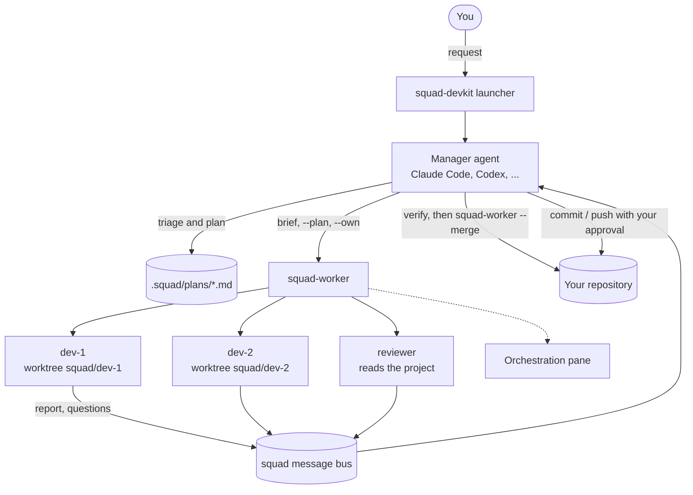
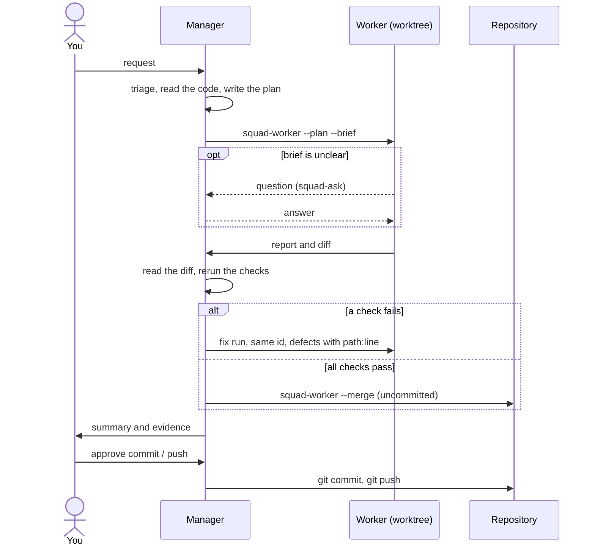

<h1 align="center">squad-devkit</h1>

<p align="center"><strong>One manager agent. On-demand workers. Fewer tokens.</strong></p>

<p align="center">
  <a href="https://github.com/bthanhtung/squad-devkit/actions/workflows/ci.yml"></a>
  <a href="https://github.com/bthanhtung/squad-devkit/releases"></a>
  <a href="./LICENSE"></a>
  
</p>

squad-devkit turns one terminal into an engineering team. You talk to a single
manager agent (Claude Code by default). The manager triages the request, plans
it, gives each task to the most cost-effective worker that can do it well
(Claude, Codex, OpenCode, Grok, or a cheap local model), verifies every
result, and sends back anything that is wrong. Workers start only when there is
work and stop when they are done, so idle agents cost nothing.

<p align="center">
  
</p>

<p align="center"><sub>A real run in tmux: three Claude haiku workers fix a bug, write tests, and update docs in parallel, each in its own git worktree, then everything is merged and the tests pass.</sub></p>

**Contents:** [Highlights](#highlights) · [How it works](#how-it-works) · [Demos](#demos) · [Install](#install) ·
[Usage](#usage) · [Workers](#workers) · [Watching workers](#watching-workers) ·
[Configuration](#configuration) · [Project status](#project-status) · [Security](#security) ·
[FAQ](#faq) · [Contributing](#contributing) · [Credits](#credits) · [License](#license) ·
[squad CLI reference](./docs/squad-cli.md)

## Highlights

- **Plans like a senior team.** Every request is triaged by risk and complexity, then planned from
  five angles: principal engineer, engineering manager, tech lead, QA, and end user.
- **Right worker for the job.** Workers are chosen by trust and cost (`claude` > `codex` > `opencode`,
  `grok` > `ccr`), using the smallest model that fits the brief.
- **The manager owns the outcome.** Reports are checked against `git diff` and verification
  commands; defects go back with `path:line` detail, escalating models if needed.
- **Workers can push back.** Workers question ambiguous briefs or propose better approaches with
  `squad-ask` instead of guessing.
- **Isolated by default.** Editing workers get their own git worktree and branch, so parallel tasks
  never overwrite each other; the manager merges changes cleanly.
- **Nothing hangs.** Workers run with time limits and stall detection; failures report back for
  reassignment or re-runs.
- **Live visibility.** One orchestration pane per manager (lifecycle flow chart, closes itself
  when idle) or one pane per worker; supported in tmux, Orca, Herdr, WezTerm, Kitty, iTerm2,
  and Ghostty.
- **Lean by design.** Instructions live in system prompts, MCP servers stay off until requested,
  and a Codex manager takes over if Claude hits usage limits.

## How it works

You talk to one manager. The manager plans and verifies; workers do the edits, each in its own git worktree. Workers exist only while they have a task.



A request moves through these steps:



| Part | What it does |
|---|---|
| `squad-devkit` | Picks the manager CLI and the workspace, then starts the manager with its role prompt (`templates/devkit/manager-devkit.md`). |
| Manager | Triages, plans from five perspectives, briefs workers, verifies every result, and reports to you. It never edits project files: a guard hook blocks edits outside `.squad/` and blocks commit or push without your approval. |
| `squad-worker` | Validates the plan, creates the worktree, starts an engine adapter (`scripts/lib/engines/`: claude, codex, opencode, grok, ccr), enforces time limits and file ownership, and merges on request. |
| `squad` | A small Rust binary that serves as the message bus and task store (`.squad/messages.db`). Workers report, ask and answer through it. |
| Orchestration pane | Live view of every worker's status and its conversation with the manager. It closes itself when the work is done. |

## Demos

**Setup wizard** — Detect installed AI CLIs and configure preferences (`squad-devkit --setup`):


**Orchestration view** — Live lifecycle flow chart and worker details (`g` graph, `c` cards, `t` tree, `j`/`k` select, `i` details, `a` all managers, `p` keep open):


**Hierarchy mode** — Root manager delegates independent areas to sub-managers (`1`–`9` zoom, `Esc` return):


**Classic panes (`--view panes`)** — Dedicated split monitor pane for each running worker:


Regenerate with `vhs scripts/demo/<name>.tape`.

## Install

Requirements: macOS or Linux, bash, git, one manager
CLI (`claude`, `codex`, `agy`, `gemini`, `grok`, or `opencode`), and at least one
worker engine (`claude`, `codex`, `opencode`, `grok`, or `ccr` from
[claude-code-router](https://github.com/musistudio/claude-code-router)).
`jq` is optional (used when present).
Monitor panes split in tmux, Orca, Herdr, WezTerm, Kitty, iTerm2, and Ghostty. In other
terminals (including Zellij), run manager workers inside tmux.

```bash
git clone https://github.com/bthanhtung/squad-devkit.git
squad-devkit/scripts/install-devkit.sh
# Or compile squad from source:
# squad-devkit/scripts/install-devkit.sh --build-squad
```

The installer links commands into `~/.local/bin` and runs a setup wizard to detect AI CLIs and
configure manager and worker preference order. Run `squad-devkit --setup` to change preferences
later. It also adds a `squad-devkit` skill to Claude Code and Codex (`~/.claude/skills`,
`~/.codex/skills`) to manage workers directly from existing sessions. Run `squad-devkit --doctor`
to check your setup. Make sure `~/.local/bin` is on your `PATH`.

## Usage

```bash
squad-devkit                                          # from ~: general workspace; in a repo: that repo
squad-devkit "check prod error logs since 18:00 and write a report"
squad-devkit my-service "add rate limiting to the public API"
squad-devkit my-service --tmux                        # or --ghostty for a new window
squad-devkit update                                   # pull latest devkit and reload inside a session
squad-devkit reload                                   # reload roles, links, views, and manager prompt
squad-devkit --version
```

Describe the work in the chat. The manager investigates, writes a plan to `.squad/plans/`, starts
workers in parallel, answers their questions, verifies their results, and reports back with evidence.
From your home directory it runs in the general workspace `~/.squad-devkit`; in a git repository it
works with that project and leaves the working tree clean.

### Update without restarting

Inside a running manager session, ask the manager to update or reload without restarting:

| Command | Action |
|---|---|
| `squad-devkit update` | Pulls latest devkit via `git pull --ff-only` and reloads scripts. |
| `squad-devkit reload` | Refreshes role templates, re-links commands, re-execs orchestration views via SIGHUP, and adopts updated manager instructions. |

## Workers

The manager runs workers for you; you can also run them yourself:

```bash
squad-worker dev-1 --engine codex --role dev --brief-file brief.md
squad-worker review-1 --engine claude --model sonnet --role reviewer --brief "Review git diff for src/api/"
squad-worker logs-1 --engine codex --role researcher --mcp grafana-logs --brief "..."
squad-worker --list                 # running workers and unmerged worktrees
squad-worker --merge dev-1          # apply dev-1's worktree changes (uncommitted)
squad-worker --discard dev-1        # or drop them
squad-worker --stop dev-1           # or --stop all
```

| Engine | Trust | Use for |
|---|---|---|
| `claude` | highest | Work that must be right the first time; `haiku` by default, `sonnet` for complex or high-risk work, `opus` for the hardest |
| `codex` | high | Normal implementation, debugging, and tests; the only engine with MCP access |
| `opencode`, `grok` | medium | Low-risk implementation or a second opinion (experimental) |
| `ccr` | basic | Docs and small exact edits; cheap model, file tools only |

Roles: `dev`, `tester`, `reviewer`, `researcher`, or any role from `.squad/roles/`. Use `--project <path>`
to work in another repository. High-risk plans require `--model-tier strong`; `--verify '<command>'`
runs after the worker in its worktree and blocks `--merge` on failure.

In git repositories, editing workers run in isolated worktrees under `.squad/worktrees/` on branch
`squad/<id>` created from a snapshot of your working tree. Your files stay untouched until
`squad-worker --merge`, which applies changes uncommitted with a three-way merge. Reviewers and
researchers read the project directly; `--no-worktree` disables isolation.

### Hierarchy mode

For complex tasks spanning multiple areas, the manager can delegate to sub-managers (`--role sub-manager`).
Sub-managers plan child tasks, review changes, and report back to root, keeping the root context lean.
Authority to merge, commit, and push remains strictly with the root manager. See
[hierarchy mode](./docs/squad-devkit.md#hierarchy-mode).

## Watching workers

Workers report progress live through an orchestration pane or dedicated per-worker panes:

| View | Mode | Behavior |
|---|---|---|
| `orchestration` | Default for manager | Single live lifecycle flow chart showing all workers, plan tasks, questions, and message timeline. Closes automatically when idle. |
| `panes` | Direct default, `--view panes` | Dedicated split pane per worker streaming events and commands under a live status line. Closes after a configurable delay. |

With claude-hud, the manager's status line shows tokens saved, for example: `squad 2 running · saved 1.2M tok (+3.4M cache) · claude workers 0.8M (+12M cache)`.

Terminal splits are supported in tmux, Ghostty, Herdr desktop/TUI, Orca, WezTerm, Kitty, and iTerm2; see [watching workers](./docs/squad-devkit.md#watching-workers) for setup details, controls, and Terminal.app/Linux fallbacks.

## Configuration

| Variable | Default | Purpose |
|---|---|---|
| `SQUAD_DEVKIT_MANAGER` | saved choice, else `claude` | Manager CLI for a run (`--manager`) |
| `SQUAD_DEVKIT_PERMISSION_MODE` | `auto` | Claude Code permission mode for the manager |
| `SQUAD_DEVKIT_FALLBACK_MANAGER` | `codex` | Manager that takes over when Claude Code hits a limit (`none` disables) |
| `SQUAD_DEVKIT_RETENTION_DAYS` | `7` | Days to keep finished worker runs |
| `SQUAD_DEVKIT_MAX_MB` | `200` | Size cap for `.squad/workers` |
| `SQUAD_DEVKIT_STATUSLINE` | `1` | `0` turns off the squad status-line label |
| `SQUAD_DEVKIT_NOTIFY` | `1` | `0` disables desktop notifications |
| `SQUAD_WORKER_CLAUDE_MODEL` | `haiku` | Default model for Claude workers |
| `SQUAD_WORKER_CODEX_PROFILE` | CLI configuration | Default Codex profile for workers |
| `SQUAD_WORKER_TIMEOUT` / `SQUAD_WORKER_STALL` | `45` / `10` | Minutes before a run is stopped / counted as stuck |
| `SQUAD_WORKER_VIEW` | `orchestration` (manager) / `panes` (direct) | Worker progress view: `orchestration` (one live flow view) or `panes` (one split per worker; `--view`, or `view=` in config) |
| `SQUAD_WORKER_VERIFY_TIMEOUT` | `10` | Minutes allowed for `--verify` |
| `SQUAD_WORKER_REPORT_LINES` | `40` | Maximum report lines printed by a worker |
| `SQUAD_ORCHESTRATION_HOLD` | `SQUAD_WORKER_PANE_HOLD`, else `60` | Seconds before an idle orchestration pane closes itself (`0` = never) |
| `SQUAD_WORKER_PANE_HOLD` | `60` | Seconds a finished monitor pane stays open (`panes` view) |
| `SQUAD_WORKER_WORKTREE` | `auto` | `0` disables git worktree isolation |
| `SQUAD_WORKER_SANDBOX` | `1` | `0` disables engine sandbox (Codex and Claude workers) |
| `SQUAD_DEVKIT_ROUTER_URL` | unset | Optional advisory triage router for `squad-route` |

`squad-devkit --clean` prunes old worker runs on demand and `--clean-all` removes every finished run.
Full reference: [docs/squad-devkit.md](./docs/squad-devkit.md).

### Model selection

`--model` beats `--model-tier fast|balanced|strong`. Run `squad config workers` after `squad init` to choose
models and assign tiers, and use `squad-worker --models` to list the local engine catalog. See
[worker model selection](./docs/squad-devkit.md#worker-model-selection) and
[worker capability tiers](./docs/squad-devkit.md#worker-capability-tiers-and-local-catalog).

### YOLO sessions

`--yolo` opts in native permission bypass for Claude, Codex, and AGY manager sessions (and Claude and Codex workers), disabling engine
permission checks and sandboxing. Use only in a trusted environment. See
[opt-in YOLO sessions](./docs/squad-devkit.md#opt-in-yolo-sessions).

## Project status

squad-devkit 1.0 runs daily on macOS with Claude Code as the manager and Codex
and ccr workers. What has been verified end to end, and what is still
experimental:

| Area | Status |
|---|---|
| Claude Code manager, Codex and ccr workers, worktrees and merging | Verified in real runs |
| Monitor panes in Herdr desktop (`herdr-app`, local spaces), Herdr TUI, tmux, and Ghostty | Verified in real runs |
| Codex manager fallback when Claude Code hits a limit | Handoff verified with a simulated limit error |
| Claude workers | File edits verified; shell commands rely on Claude Code's sandbox |
| `grok` workers; `agy`, `gemini`, `grok`, `opencode` managers | Experimental: built from each CLI's documentation, covered by tests with stand-in CLIs. `agy` is manager-only: Antigravity blocks CLI calls from other AI agents, so it cannot run as a worker |
| Panes in Orca, WezTerm, Kitty, iTerm2, Zellij; dashboard in Terminal.app and Linux desktops | Experimental: built from each terminal's documented API, covered by tests with stand-in commands |
| Linux | Covered by CI (Ubuntu); real-world reports welcome |

If you try an experimental path, please report what worked or failed in an
[issue](https://github.com/bthanhtung/squad-devkit/issues/new/choose).

## Security

Codex workers run sandboxed to the project, Claude workers accept edits and run shell commands only inside
Claude Code's sandbox, and ccr workers get file tools only. squad-devkit never stores credentials, and
worker prompts forbid reading them from configuration files. See [SECURITY.md](./SECURITY.md) for details
and how to report a vulnerability.

## FAQ

**Why not just use Claude Code subagents?**
Subagents run inside your Claude Code session on Claude models, so every task draws from the same
quota. squad-devkit keeps Claude for planning and review and sends the bulk of the work to other
engines (Codex, cheap ccr models), each in its own process and git worktree, with a time limit and
a live pane you can watch or stop.

**How many tokens does it actually save?**
Two measured examples: a trivial edit by a Codex worker costs about 18k tokens instead of 52–98k,
because workers start with MCP servers off; and the earlier setup with three always-on workers
burned about 1M tokens polling before any work arrived, which on-demand workers avoid entirely.
The status line shows the running total for your own session. See
[Why this saves tokens](./docs/squad-devkit.md#why-this-saves-tokens).

**Do I need Claude Code?**
No. It is the default and best-tested manager, but Codex, Gemini CLI, Grok, Antigravity, and
OpenCode can manage too (`squad-devkit --setup`).

**Can a worker break my repository?**
Editing workers never touch your working tree. They work on a `squad/<id>` branch in
`.squad/worktrees/`, and nothing reaches your files until the manager (or you) runs
`squad-worker --merge`, which leaves the changes uncommitted for review.

**Windows?**
Not supported yet. WSL has not been tested; reports are welcome.

## Contributing

Contributions are welcome. See [CONTRIBUTING.md](./CONTRIBUTING.md) for the development setup and
the checks CI runs, and [CHANGELOG.md](./CHANGELOG.md) for release notes.

## Credits

squad-devkit is built by [TungDaDev](https://github.com/bthanhtung) on
[squad](https://github.com/mco-org/squad) by mco-org, which provides the SQLite message bus,
task records, and the `squad` CLI.

## License

squad-devkit is released under the [GNU General Public License v3.0](./LICENSE). You may use,
study, share, and modify it; if you distribute a modified version, it must stay under GPL-3.0 with
its source available.

The code that comes from the upstream squad CLI keeps its original MIT license and copyright notice,
in [LICENSES/MIT-squad.txt](./LICENSES/MIT-squad.txt).
