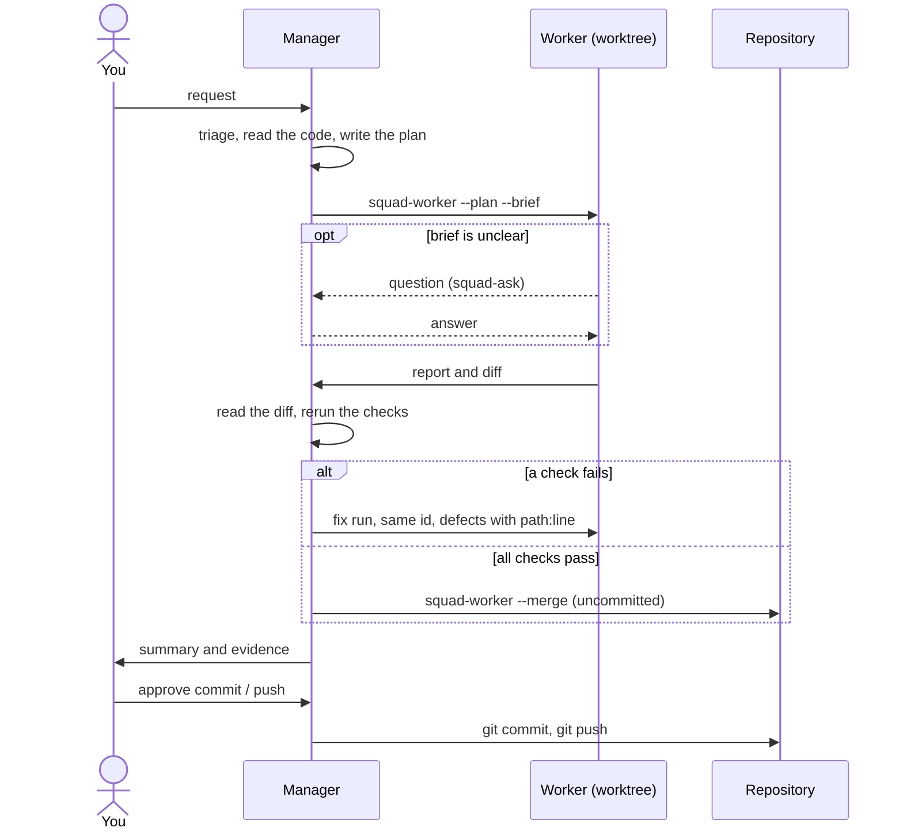

<h1 align="center">squad-devkit</h1>

<p align="center"><strong>One expensive manager plans and checks. Cheap workers do the typing. Idle agents cost nothing.</strong></p>

<p align="center">
  <a href="https://github.com/bthanhtung/squad-devkit/actions/workflows/ci.yml"></a>
  <a href="https://github.com/bthanhtung/squad-devkit/releases"></a>
  <a href="./LICENSE"></a>
  
</p>

squad-devkit turns one terminal into an engineering team. You talk to one manager agent.
It plans the work, hands each task to the cheapest worker that can do it, and checks every result
before anything reaches your repository.

- **Fewer tokens.** Workers start only when there is work, so nothing polls while idle.
- **Parallel and safe.** Each editing worker gets its own git worktree and branch.
- **Verified before merge.** The manager reads the diff and reruns the checks.
- **Your choice of engine.** Claude, Codex, OpenCode, Grok and ccr.
- **Nothing hangs.** Time limits and stall detection report failures back.

<p align="center">
  
</p>

<p align="center"><sub>A real run in tmux: three Claude haiku workers fix a bug, write tests, and update docs in parallel, each in its own git worktree, then everything is merged and the tests pass.</sub></p>

## Quick start

```bash
git clone https://github.com/bthanhtung/squad-devkit.git
squad-devkit/scripts/install-devkit.sh
squad-devkit "your request"
```

Needs macOS or Linux, bash, git, one manager CLI (such as `claude`) and one worker engine. Make sure `~/.local/bin` is on your `PATH`. Run `squad-devkit --doctor` to check your setup.

## How it works

You talk to one manager. The manager plans and verifies; workers do the edits, each in its own git worktree.


A request moves through these steps:



| Part | What it does |
|---|---|
| `squad-devkit` | Picks the manager CLI and the workspace, then starts the manager with its role prompt (`templates/devkit/manager-devkit.md`). |
| Manager | Triages, plans from five perspectives, briefs workers, verifies every result, and reports to you. It never edits project files: a guard hook blocks edits outside `.squad/` and blocks commit or push without your approval. |
| `squad-worker` | Validates the plan, creates the worktree, starts an engine adapter (`scripts/lib/engines/`: claude, codex, opencode, grok, ccr), enforces time limits and file ownership, and merges on request. |
| `squad` | A small Rust binary that serves as the message bus and task store (`.squad/messages.db`). Workers report, ask and answer through it. |
| Orchestration pane | Live view of every worker's status and its conversation with the manager. It closes itself when the work is done. |

## Workers

| Engine | Trust | Use for |
|---|---|---|
| `claude` | highest | Work that must be right the first time; `haiku` by default, `sonnet` for complex or high-risk work, `opus` for the hardest |
| `codex` | high | Normal implementation, debugging, and tests; the only engine with MCP access |
| `opencode`, `grok` | medium | Low-risk implementation or a second opinion (experimental) |
| `ccr` | basic | Docs and small exact edits; cheap model, file tools only |

The manager runs workers for you. You can also run them yourself:

```bash
squad-worker dev-1 --engine codex --role dev --brief-file brief.md
squad-worker --list                 # running workers and unmerged worktrees
squad-worker --merge dev-1          # apply dev-1's worktree changes (uncommitted)
squad-worker --stop dev-1           # or --stop all
```

## Learn more

- [Full guide](./docs/squad-devkit.md): [highlights](./docs/squad-devkit.md#highlights), [configuration](./docs/squad-devkit.md#configuration-reference), [model selection](./docs/squad-devkit.md#worker-model-selection), [hierarchy mode](./docs/squad-devkit.md#hierarchy-mode), [watching workers](./docs/squad-devkit.md#watching-workers), [YOLO sessions](./docs/squad-devkit.md#opt-in-yolo-sessions), [project status](./docs/squad-devkit.md#project-status), [FAQ](./docs/squad-devkit.md#faq)
- [squad CLI reference](./docs/squad-cli.md)
- [Changelog](./CHANGELOG.md)
- Demos: [setup wizard](./assets/demo/setup-wizard.gif), [orchestration view](./assets/demo/orchestration-graph.gif), [hierarchy mode](./assets/demo/hierarchy.gif), [classic panes](./assets/demo/panes.gif)

## Security

Codex workers run sandboxed to the project. Claude workers run shell commands only inside Claude Code's sandbox. ccr workers get file tools only. squad-devkit never stores credentials. See [SECURITY.md](./SECURITY.md) to report a vulnerability.

## Contributing

Contributions are welcome. See [CONTRIBUTING.md](./CONTRIBUTING.md) for the setup and the checks CI runs.

## Credits

Built by [TungDaDev](https://github.com/bthanhtung) on [squad](https://github.com/mco-org/squad) by mco-org, which provides the SQLite message bus and the `squad` CLI.

## License

Released under the [GNU General Public License v3.0](./LICENSE). Code from the upstream squad CLI keeps its MIT license in [LICENSES/MIT-squad.txt](./LICENSES/MIT-squad.txt).
